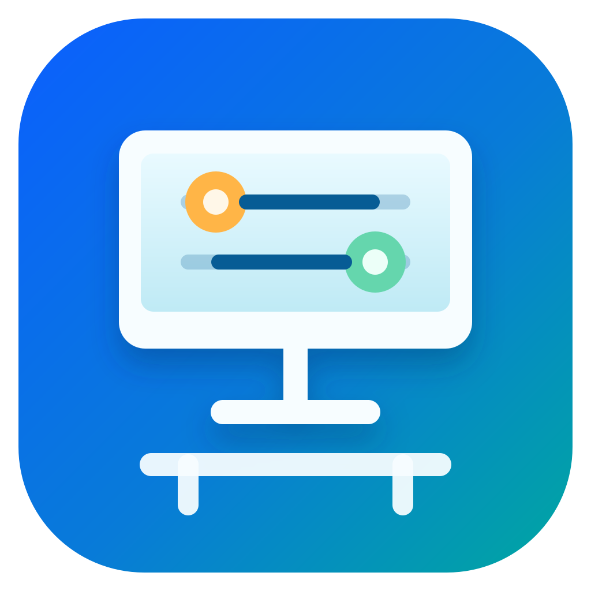
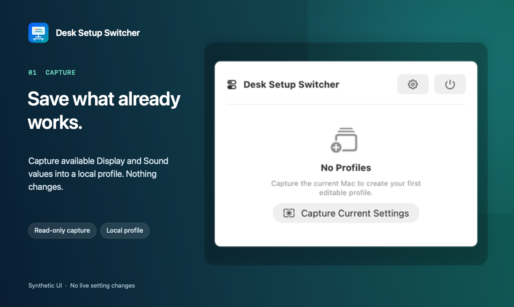
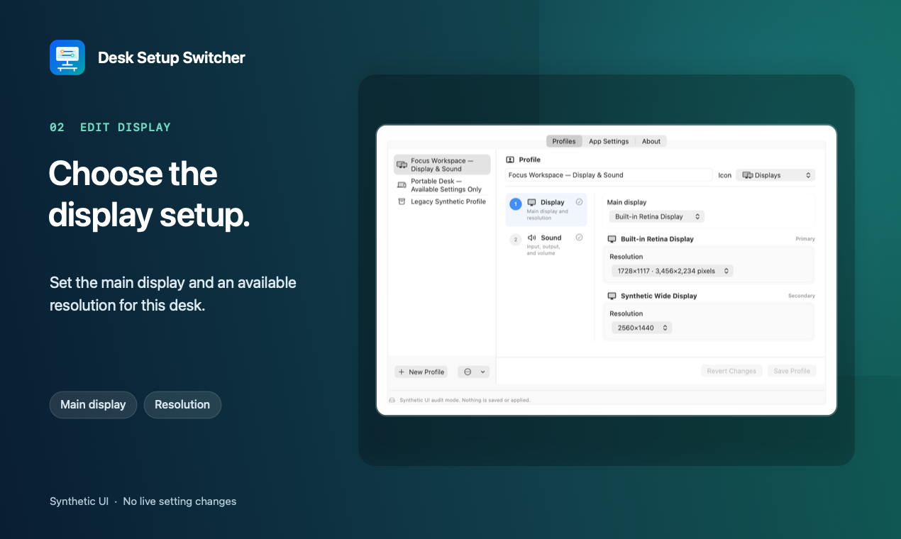
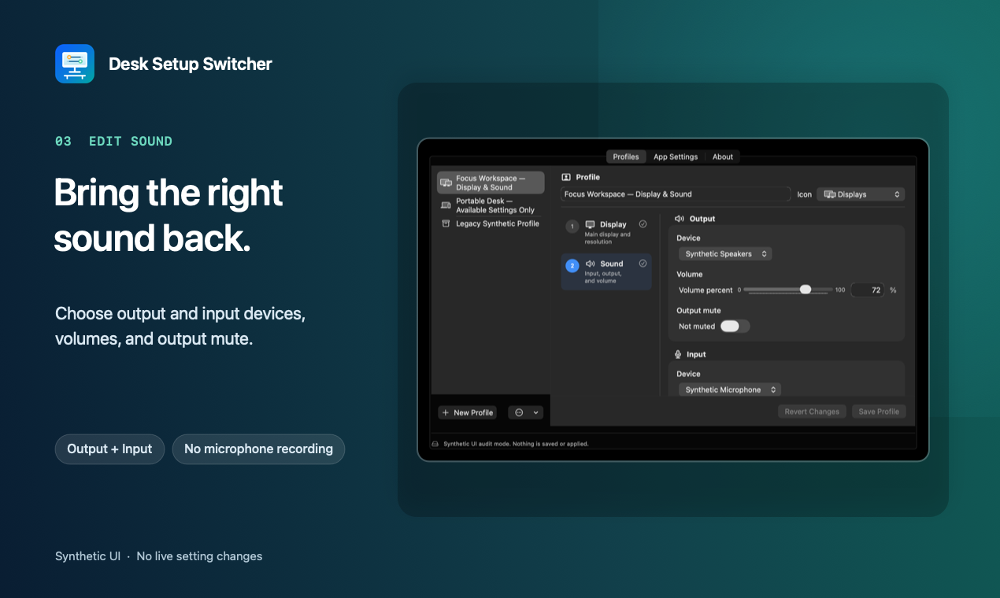
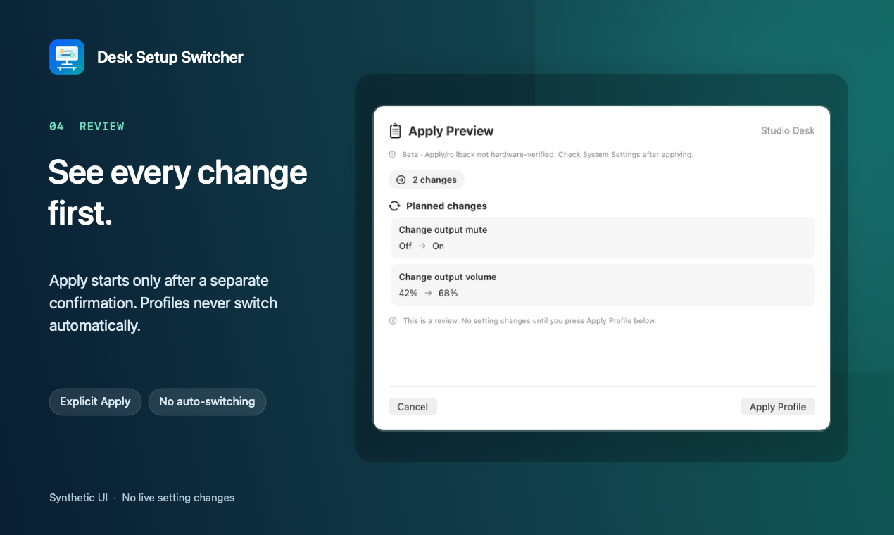

<p align="center">
  
</p>

<h1 align="center">Desk Setup Switcher</h1>

<p align="center"><strong>Bring your desk back, deliberately.</strong></p>

<p align="center">
  Move between desks without rebuilding your Mac setup.<br>
  Save sound and keyboard settings as local profiles, preview every proposed change, and apply only when you are ready.
</p>

<p align="center">
  <a href="https://github.com/GGULBAE/desk-setup-switcher/actions/workflows/ci.yml"></a>
  <a href="LICENSE"></a>
  
</p>

<p align="center">
  <a href="https://ggulbae.github.io/desk-setup-switcher/">Project site</a> ·
  <a href="docs/guides/USER-GUIDE.md">English guide</a> ·
  <a href="docs/guides/USER-GUIDE.ko.md">한국어 가이드</a> ·
  <a href="docs/SUPPORT-MATRIX.md">Support matrix</a>
</p>

Desk Setup Switcher is a macOS menu-bar app for people who use the same Mac at different desks. Capture the setup that works at home, the office, or a studio, then return to it without hunting through System Settings each time.

> [!IMPORTANT]
> **The project site is public, but there is no supported public download yet.** The [GitHub Pages site](https://ggulbae.github.io/desk-setup-switcher/) is an informational holding page, not an app release. The first supported build is planned as a free, Developer ID-unsigned DMG on [GitHub Releases](https://github.com/GGULBAE/desk-setup-switcher/releases) after the [public-beta completion gates](docs/COMPLETION-CRITERIA.md) pass. Local builds and ordinary CI artifacts are unsupported.

## See the whole flow

<table>
  <tr>
    <td width="50%"></td>
    <td width="50%"></td>
  </tr>
  <tr>
    <td width="50%"></td>
    <td width="50%"></td>
  </tr>
</table>

<p align="center">
  <a href="site/public/demo/desk-setup-switcher.mp4">Watch the 40-second silent product tour</a> ·
  <a href="site/public/demo/captions.en.vtt">English captions</a> ·
  <a href="site/public/demo/captions.ko.vtt">한국어 자막</a>
</p>

<p align="center"><sub>Historical exact-commit synthetic Display/Sound product data captured before the Keyboard surface was added and before Display was retired from the current profile workflow. No personal device identifiers, live Capture, Apply, or hardware changes.</sub></p>

## One Mac, more than one desk

Changing desks often means repeating the same small decisions: select the right speakers or microphone, reset their levels, and restore keyboard repeat preferences.

Desk Setup Switcher keeps those choices together in a named profile, so every change begins with a clear plan instead of guesswork.

## Why Desk Setup Switcher?

| Product value | What you get |
| --- | --- |
| **Less setup repetition** | Keep the sound and keyboard choices for each desk together in one named profile. |
| **Control before convenience** | See the exact plan, unavailable items, and risks before anything changes. Profiles never switch automatically. |
| **A deliberately narrow scope** | Only the seven visible Sound and Keyboard settings can be captured or applied. |
| **Privacy by architecture** | No account, cloud sync, app-owned server, telemetry, analytics, advertising, or automatic/background profile switching. |

## Capture. Review. Get back to work.

1. **Capture** reads the current Sound and Keyboard values into a local profile. It changes nothing.
2. **Edit** gives the setup a useful name. Turn Sound Output, Sound Input, or Keyboard on/off, then select the individual settings to apply.
3. **Review & Apply** shows proposed changes and omissions. Only a separate confirmation starts the change.

The requested [v0.0.9 development preview](https://github.com/GGULBAE/desk-setup-switcher/releases/tag/v0.0.9) delivers the DMG and checksum separately from the planned supported v0.1.0 beta. See its notes for unsigned-installation and verification limits. The [delivery dependency preflight](docs/DEPENDENCY-REFRESH-2026-11-13.md) records the pinned security updates and verification.

## One profile, seven setting types

| Sound output | Sound input | Keyboard |
| --- | --- | --- |
| Output device | Input device | Key repeat speed |
| Output volume | Input volume | Repeat delay |
| Output mute |  |  |

That is the complete current product scope. Display settings, keyboard brightness, pointer speed, natural scrolling, standard-function-key behavior, Network settings and automatic switching are not current features. Older profile JSON can retain those values for compatibility, but Capture and Apply keep them dormant.

The [selective-settings UI audit](docs/UI-SELECTIVE-SETTINGS-AUDIT-2026-11-13.md) records the layout changes, screenshots, and mock/hardware verification boundary. Full non-live `make verify` and `git diff --check` pass for the 2026-11-13 working tree, including universal Debug/Release builds, static analysis, and local DMG verification; this does not establish hardware support.

## Designed to earn trust

- Capture is read-only, and Apply always starts with a visible plan and explicit confirmation.
- Only enabled settings are applied. Turning a section off keeps its saved values; turning it on selects its populated settings. Individual checkboxes let you keep, for example, the current device while changing only volume.
- Save/load, import/export, and recapture preserve explicit exclusions. A first Capture includes readable values; no missing value is invented.
- The app reads current state again immediately before execution. If the plan changed, it applies nothing and returns to review.
- Hidden legacy Display and Keyboard values are normalized out before planning, including in Force mode.
- Results distinguish applied, skipped, failed, rolled-back, rollback-failed, and unverified outcomes.
- Selecting an audio input device does not record audio or require microphone access.

Profiles, backups, and diagnostics stay on the Mac. Exports can contain device labels and stable identifiers, so review them before sharing. See the [privacy policy](docs/PRIVACY.md) for the complete boundary.

## Current beta status

- The bilingual project site is approved for public GitHub Pages hosting while its release state remains `holding`; it provides no app download or installation instructions.
- The initial public-beta target is Apple Silicon on macOS 14 Sonoma. Exact release-candidate lifecycle evidence is still required before that becomes a supported public claim.
- Current-source Sound Capture and device discovery have read-only hardware evidence. Keyboard Capture, Apply, and rollback have deterministic mock evidence only; no live keyboard mutation or hardware verification is claimed. The Keyboard editor uses macOS-aligned discrete **Slow → Fast** and **Long → Short** axes instead of raw preference numbers. Native key-repeat **Off** is a separate runtime threshold state and is not exposed until it can be captured, persisted, read back, and rolled back safely; the slowest enabled value is never mislabeled as Off. Key repeat speed and repeat delay use experimental undocumented preference keys. Display settings and keyboard brightness are legacy profile data only: their values are preserved for format compatibility but are never captured, edited, or applied.
- A user-authorized 2026-09-15 local Apple Silicon build of the current Keyboard source was reinstalled and launched with both profile files unchanged. This is startup evidence for an `arm64` development bundle, not universal-package, supported-release, or Keyboard hardware evidence; see the [reinstall record](docs/KEYBOARD-REINSTALL-2026-09-15.md).
- The app release remains on hold until the documented lifecycle, external-beta, and release-publication gates pass.

For the evidence behind each statement, see the [support matrix](docs/SUPPORT-MATRIX.md) and [completion ledger](docs/COMPLETION-CRITERIA.md).

## Follow the public beta

- Visit the [project site](https://ggulbae.github.io/desk-setup-switcher/), follow the [repository](https://github.com/GGULBAE/desk-setup-switcher), and check [GitHub Releases](https://github.com/GGULBAE/desk-setup-switcher/releases) for launch updates.
- Read the [distribution guide](docs/DISTRIBUTION.md) before installing an unsigned beta.
- Use [GitHub Issues](https://github.com/GGULBAE/desk-setup-switcher/issues) for non-sensitive feedback and [SECURITY.md](SECURITY.md) for security reports.

## Build from source

Contributors need full Xcode and a Swift 6.1-or-later toolchain.

```sh
git clone https://github.com/GGULBAE/desk-setup-switcher.git
cd desk-setup-switcher
make verify
```

`make verify` is the canonical non-live gate. It does not mutate display, audio, network, mouse, or keyboard settings. See [CONTRIBUTING.md](CONTRIBUTING.md) for the development workflow.

## Documentation

- **Use the app:** [English guide](docs/guides/USER-GUIDE.md) · [한국어 가이드](docs/guides/USER-GUIDE.ko.md) · [Support](SUPPORT.md)
- **Understand the boundaries:** [Privacy](docs/PRIVACY.md) · [Support matrix](docs/SUPPORT-MATRIX.md) · [Product scope](docs/PRODUCT.md)
- **Build or integrate:** [Profile JSON schema](docs/PROFILE-SCHEMA.md) · [Architecture](docs/ARCHITECTURE.md) · [Adapter contract](docs/ADAPTER-CONTRACT.md)
- **Track publication:** [GitHub Pages policy](docs/GITHUB-PAGES-PUBLICATION.md) · [Distribution gates](docs/DISTRIBUTION.md) · [External-beta report contract](docs/EXTERNAL-BETA-REPORT-TEMPLATE.md) · [Completion ledger](docs/COMPLETION-CRITERIA.md)

## Open source

Desk Setup Switcher is available under the [MIT License](LICENSE). Contributions are welcome—start with [CONTRIBUTING.md](CONTRIBUTING.md) and the [Code of Conduct](CODE_OF_CONDUCT.md).
