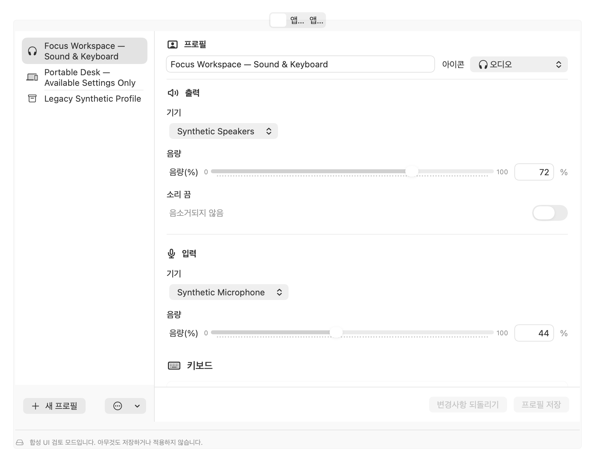
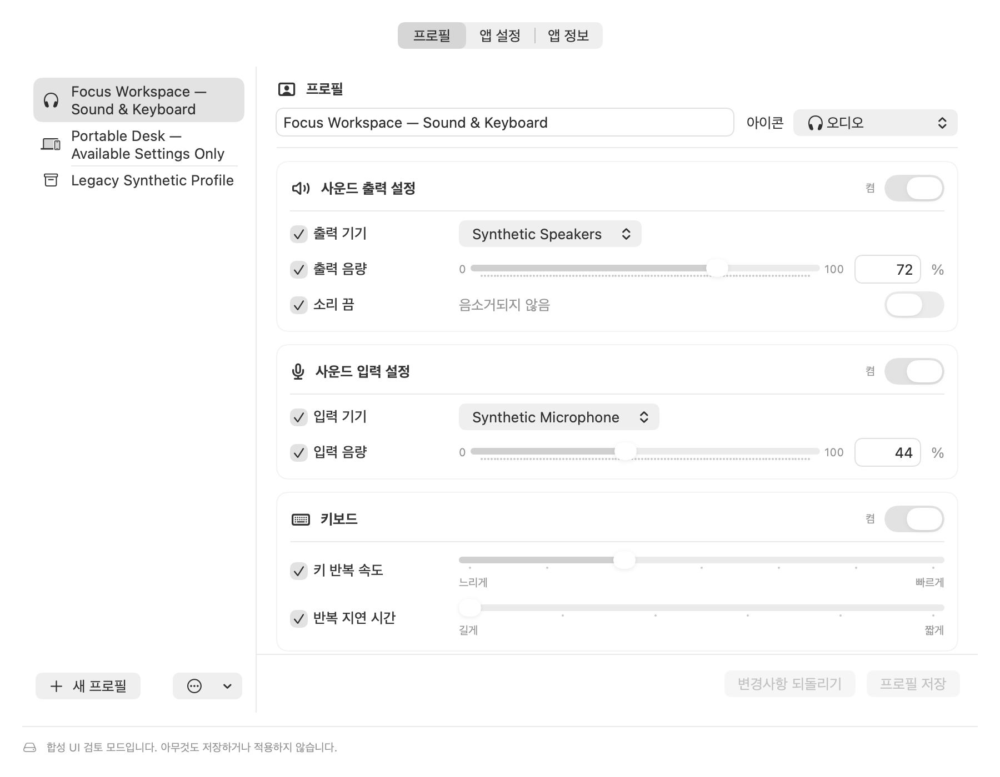
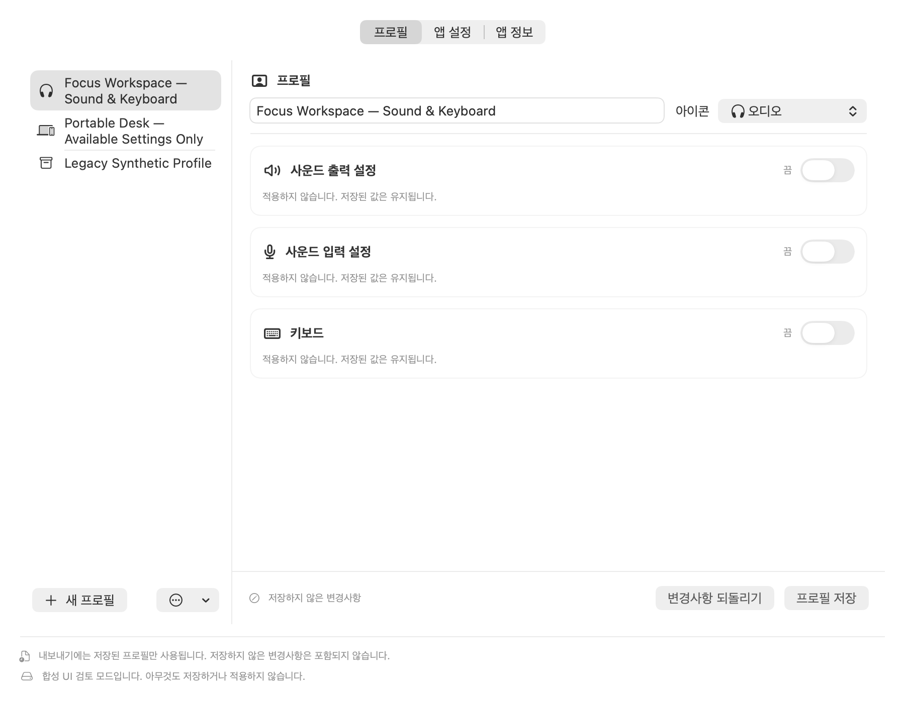
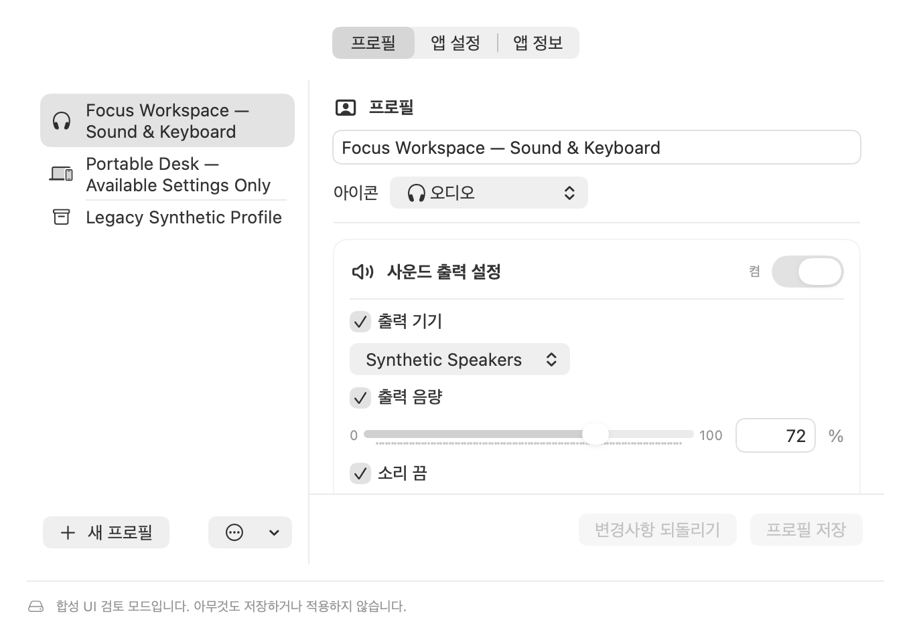

# 선택 적용과 설정 화면 검수 — 2026-11-13

## 범위와 근거

이번 실행에서 현재 SwiftUI `RuntimeSettingsRoot`를 합성 프로필과 읽기 전용 mock snapshot으로 연결한 offscreen NSWindow를 렌더링했다. 실제 장치 식별자나 개인 설정을 사용하지 않았다. 설치된 앱 조작이나 라이브 설정 변경은 하지 않았다. 기준 HEAD는 `b9a820a2`이며, 작업 시작 시부터 존재하던 미커밋 변경을 보존했다.

## 1. 기존 편집 화면 — 개선 필요



900×700 포인트에서 탭 이름이 잘리고, 기기 선택기와 음량 슬라이더의 시작 위치·폭이 제각각이었다. 항목별 세로 여백 때문에 키보드 컨트롤이 화면 아래로 밀렸으며, 적용에서 제외할 선택지도 없었다. 코드 확인 결과 오디오 값이 존재하면 정규화가 `isIncluded`를 강제로 켜는 것이 선택 적용을 막는 원인이었다.

## 2. 편집과 적용 범위 선택 — 개선 반영



사운드 출력 설정, 사운드 입력 설정, 키보드를 같은 폭의 영역으로 나누었다. 각 영역에 켬/끔 스위치를 두고 세부 항목마다 포함 체크박스를 제공한다. 장치 변경을 제외하고 음량만 적용할 수 있다. 기본 글자 크기에서는 레이블과 컨트롤의 시작 위치를 맞췄다. 같은 900×700 화면에 일곱 항목이 모두 보이며, 편집기 전체에 세로 스크롤 하나만 둔다. 상단은 기본 segmented Picker로 바꾸어 탭 이름을 표시한다. 디스플레이는 UI 및 현재 Capture/Apply 경로에서 제외된다.

## 3. 모든 설정 Off — 개선 반영



꺼진 영역은 짧은 안내로 접고 저장 값은 유지한다. 색상과 별도로 켬/끔 상태를 글자로 표시한다. 다시 켜면 값이 있는 항목을 선택하고 세부 체크박스로 조정한다. 정상·가능한 항목만 적용 모두 꺼진 항목을 계획하지 않으며, 전부 Off이면 변경 작업은 없다. 저장/불러오기/JSON 가져오기·내보내기/재캡처에서도 명시적인 제외를 보존한다. 읽을 수 있는 값이 전혀 없는 영역은 안내와 함께 활성화 스위치를 비활성화한다.

## 4. 작은 창과 큰 글자 — 개선 반영



680×480 포인트와 accessibility3에서는 레이블·컨트롤을 세로로 배치한다. 이름/아이콘도 폭에 따라 줄을 바꾸고, 하단 저장 및 새 프로필 작업은 스크롤 밖에 유지한다. 이 크기에서는 세로 스크롤이 필요하다. 기본 SwiftUI Picker, Toggle, Slider, Button의 키보드 동작을 유지하며 영역/항목의 접근성 이름과 힌트를 제공한다. offscreen 접근성 트리에는 가상 자식이 완전히 노출되지 않으므로 VoiceOver 실제 탐색과 키보드 조작은 별도 수동 검증 사항이다.

## 검증

- 모의 Core Audio: 32가지 세부 선택 조합 × normal/force 두 모드에서 선택된 작업만 적용하고 역순으로 되돌림. 실제 장치 API는 호출하지 않는다.
- 제외된 연결 해제 장치가 현재 출력 장치의 선택된 음량 변경을 막지 않는 실패 경로를 검사한다.
- 세 영역의 8가지 선택 조합, JSON 왕복, all-off 재캡처, 편집·저장·다시 불러오기의 제외 상태 보존을 검사한다.
- 한영, 밝은/어두운 화면, 최소 창 크기, 큰 글자, 지원 불가 상태의 offscreen 회귀 검증을 실행한다.
- 전체 `make verify` 및 `git diff --check`: 통과. 기능·모의·한영 화면 검사, 네이티브 팝오버 검사, 릴리스 도구 모의 검사, arm64/x86_64 Debug/Release 빌드, 정적 분석, 로컬 DMG 및 앱 메타데이터·리소스 검증이 완료됐다. 검증 중 발견한 기존 팝오버 fixture의 중복 해제는 `NSWindow.isReleasedWhenClosed = false`로 소유권을 명시하여 수정했고 전체 재실행도 통과했다.
- 로컬 산출물: `artifacts/Desk-Setup-Switcher-0.0.9-unsigned.dmg`. 설치하지 않은 개발 빌드이며, 현재 소스 변경과 검수 증거는 미커밋 상태다.
- 실제 하드웨어 적용/복원, VoiceOver 수동 검수, 설치·배포: 실행하지 않음.

재현 명령은 다음과 같다. Xcode 선택은 이 명령 환경에만 적용되며 OS 설정은 바꾸지 않는다.

```sh
DEVELOPER_DIR=/Applications/Xcode.app/Contents/Developer \
DESK_SETUP_WRITE_REFINEMENT_EVIDENCE=1 \
DESK_SETUP_REFINEMENT_EVIDENCE_DIR="$PWD/.build/ui-review-2026-11-13/after" \
swift test --filter TrayOffscreenEvidenceTests/rendersSimplifiedProfileSections

DEVELOPER_DIR=/Applications/Xcode.app/Contents/Developer make verify
git diff --check
```

완료 원장의 항목은 커밋 증거가 생기기 전까지 체크하지 않는다.
